# Weport

在电脑上阅读、搜索、导出和分析自己的微信聊天记录。

**下载使用：** [前往下载页面](https://github.com/Panther114/Weport/releases)。当前版本为 **v1.3.0**，本次提供 Windows 安装包。下方截图全部使用虚构数据。

## 开始使用

### Windows

1. 在下载页面选择 `Weport-版本号-Setup.exe`，安装并打开。
2. 进入「连接微信」，选择微信数据目录和账号。通常可以自动找到 `xwechat_files` 文件夹。
3. 已有数据库密钥时，粘贴密钥并连接；没有密钥时，按下方步骤获取。
4. 连接成功后，可以阅读和搜索聊天。需要备份时，进入「导出数据」，选择会话、时间范围、格式和保存位置。

### 获取数据库密钥

微信聊天数据库经过加密，Weport 需要密钥才能读取。密钥不是微信登录密码。

1. 在电脑版微信的「设置 → 通用」中关闭「自动登录」，然后退出当前登录。
2. 在 Weport 点击「提取密钥」，等待「已准备就绪」。
3. 用手机扫码登录电脑版微信。Weport 会在登录时捕获密钥并填入。
4. 点击「确认密钥并连接」。已有密钥也可以直接粘贴，无需重复提取。

提取失败时，先打开「连接诊断」，按检查结果处理。不要反复删除数据目录或配置。

## 可以做什么

### 阅读聊天、生成回复草稿

按会话和时间阅读聊天，跳转到原消息。V1.3 支持选择聊天片段，再选择 WeClone 人格生成回复草稿；生成前可以检查选中的内容，生成后自行编辑、复制。

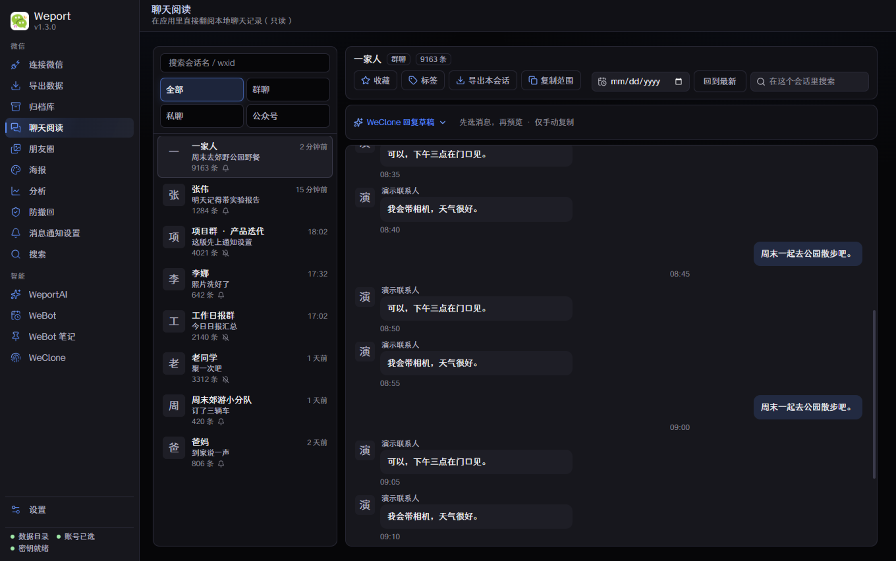
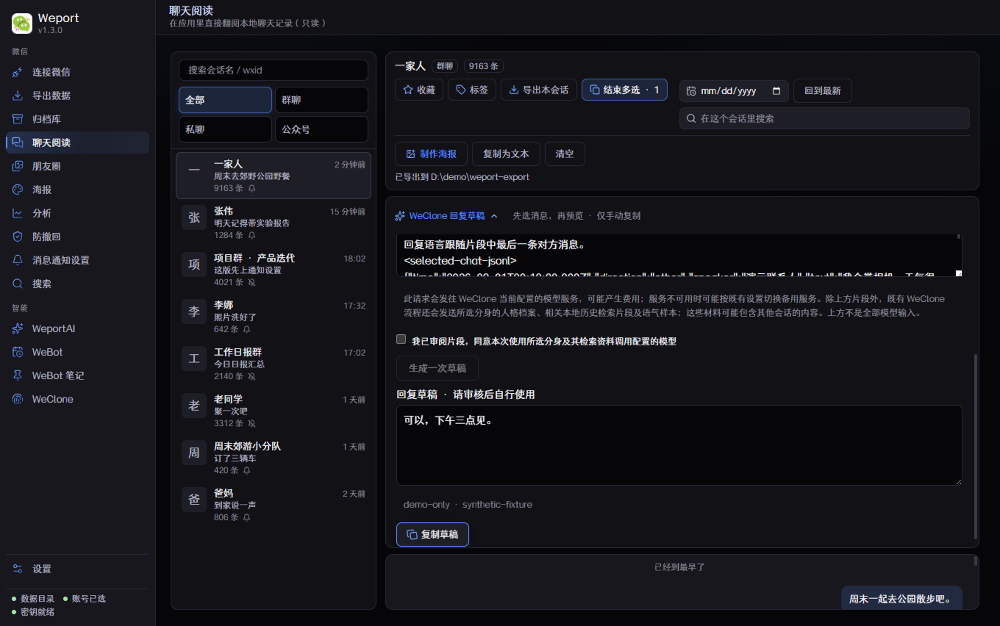

### 搜索聊天

跨会话搜索，按账号、会话、日期、发送者或消息类型缩小范围，再打开原消息。V1.3 还可配置本机语义模型，查找意思相近的内容；这是可选的实验功能，需要另行配置。

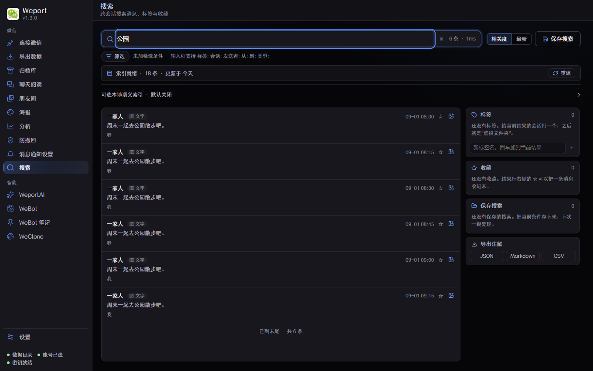

### 导出聊天

选择会话、时间范围、文件格式和是否包含图片、视频、语音等附件。V1.3 的时间范围精确到秒：

- **仅原图**：只导出能够确认的原图；原图不可用时会说明原因。
- **尽可能导出**：根据本机已有文件，使用可用的图片版本，可能包含缩略图。
- **增量导出**：检查已有导出和附件，补充新增内容或重建损坏文件。

微信本机没有保存的附件，Weport 无法凭空恢复。

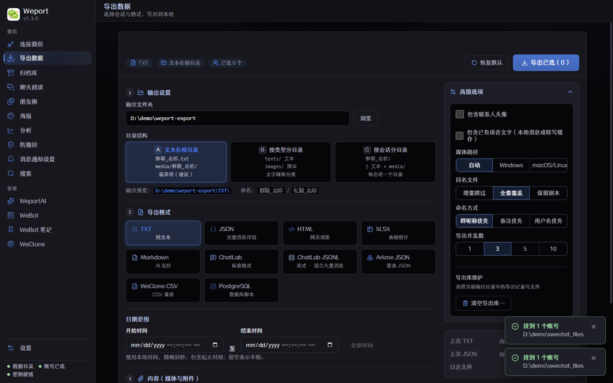

| 格式 | 适合用途 |
|---|---|
| TXT | 直接阅读纯文本 |
| HTML | 用浏览器阅读，包含可用附件 |
| JSON | 保留消息详情，便于后续处理 |
| XLSX | 用电子表格整理和统计 |
| Markdown | 在笔记工具中阅读和整理 |
| ChatLab / JSONL / Arkme JSON | 导入支持这些格式的软件 |
| WeClone CSV | 准备 WeClone 语料 |
| PostgreSQL SQL | 导入数据库 |

### 归档与离线阅读（V1.3）

将聊天保存为可携带的归档，离线阅读并添加书签、注解。支持定时归档和中断恢复。保留计划只会清理已被新归档完整覆盖、且通过校验的旧归档。

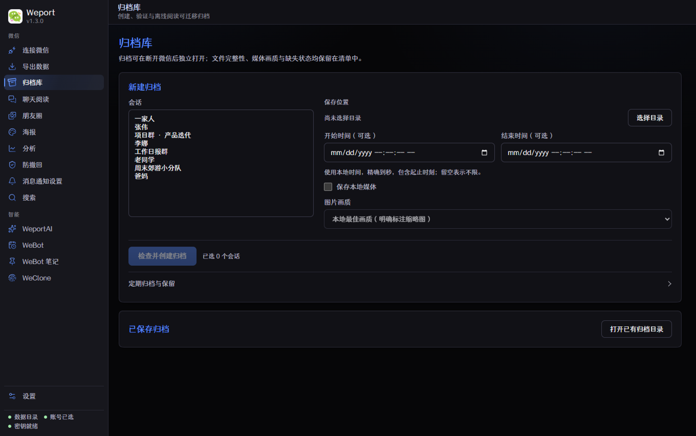

### 用 AI 分析聊天

在设置中配置模型后，可以让 WeportAI 整理事件、分析关系或查找线索。广泛分析优先连续阅读不同时间段的聊天，再针对具体线索搜索。

V1.3 增加原文来源、已阅读范围说明和按账号分开的记忆。可以检查引用、纠正记忆，并限制允许读取的数据。AI 可能出错，也可能只读到部分历史，请结合原文判断。

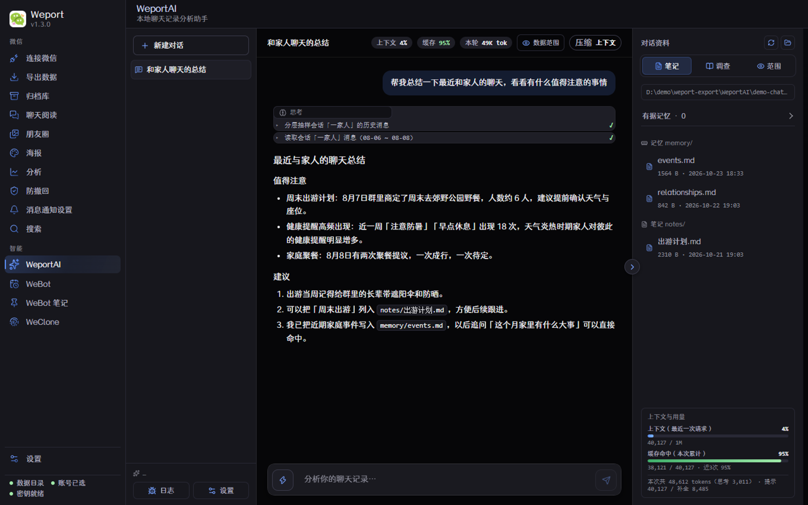

### 定时整理与笔记

WeBot 按设定时间分析聊天并保存笔记。V1.3 支持只整理新增消息、避免重复保存，以及限制运行用量。远程模型可能按使用量收费，费用以模型服务商为准。

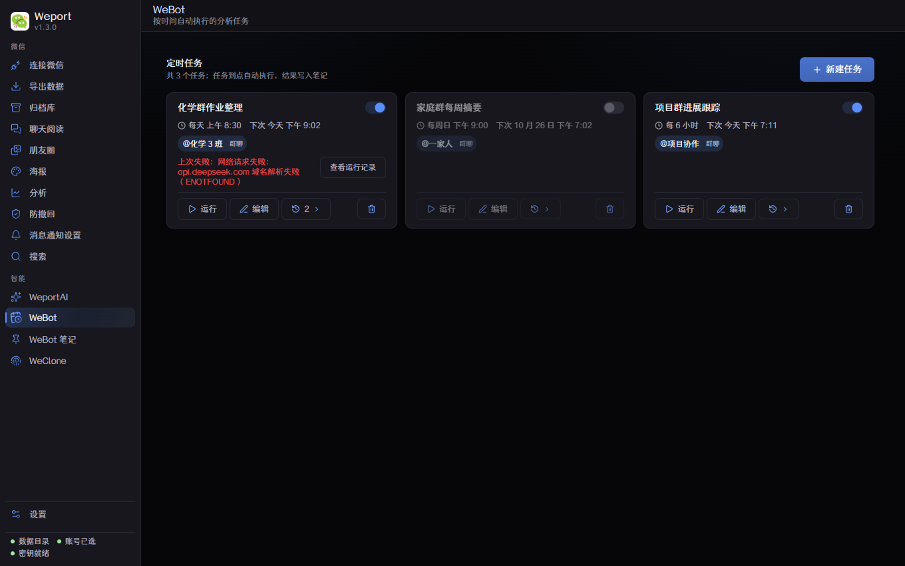
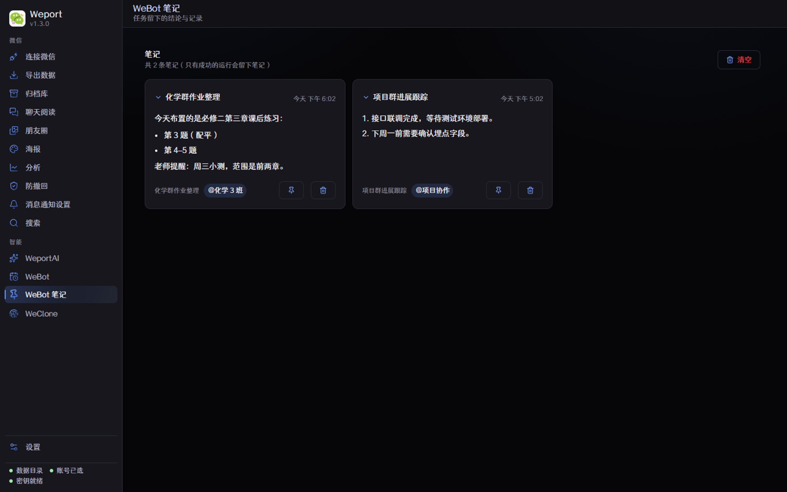

### 浏览朋友圈与查看统计

浏览微信已缓存在本机的朋友圈，按发布者、关键词或日期筛选，并导出内容。可读范围取决于本机保存的记录，不代表完整朋友圈历史。

统计页面提供私聊、群聊和年度统计，例如聊天频率、活跃时段和消息类型。统计在本机计算，不需要 AI。

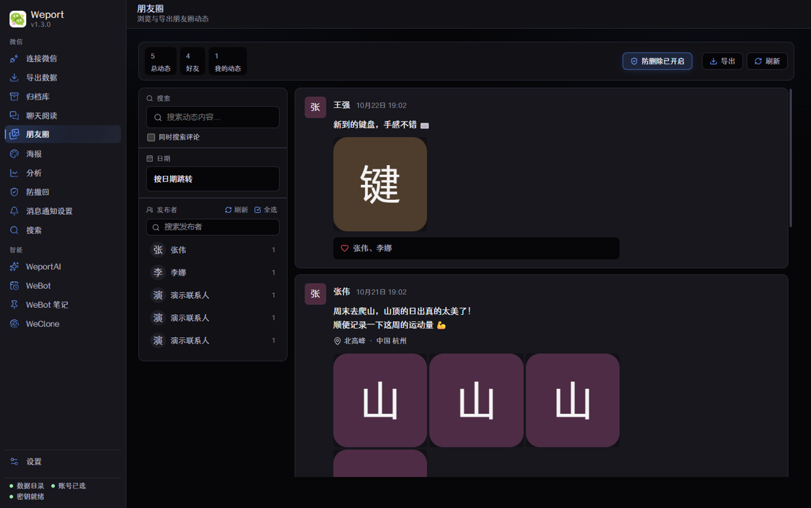
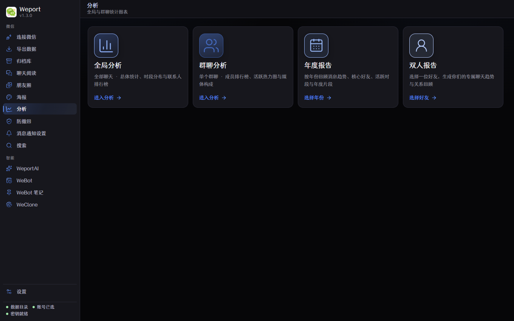

### WeClone 人格对话

从聊天中整理人格资料，并使用自己配置的模型进行对话。资料保存在本机；调用远程模型时，相关资料和聊天样本会发送给该模型服务。没有公开发布或链接分享服务。

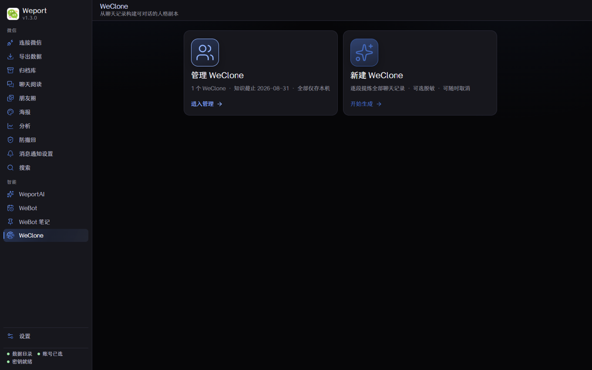

### 通知与防撤回

按会话设置消息通知，查看防撤回功能的安装状态。朋友圈防删除可保留拦截生效后在本机留存的内容，不能恢复所有过去已删除的数据。通知截图仅展示设置界面。

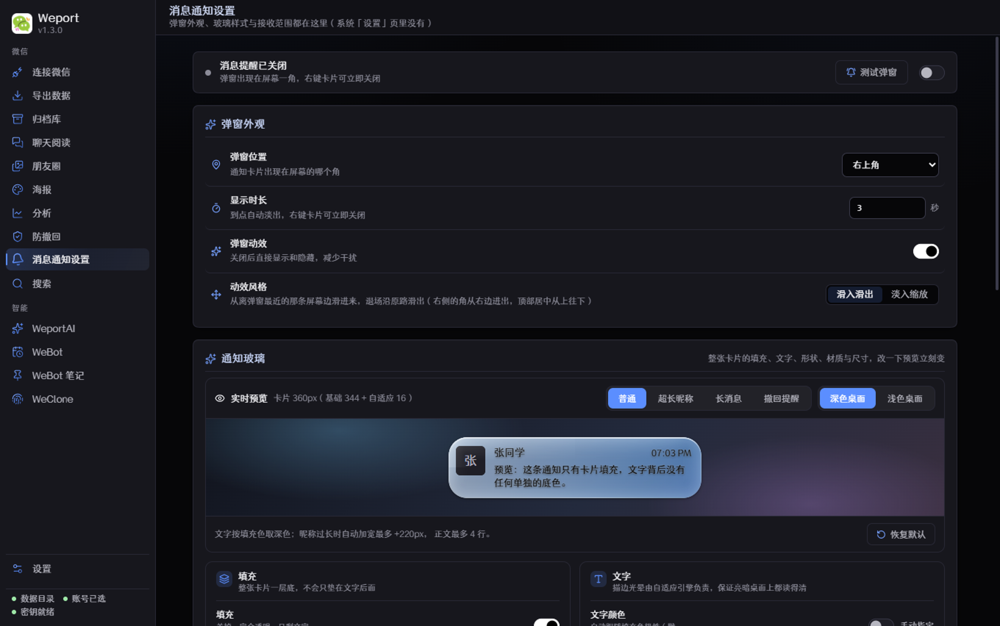
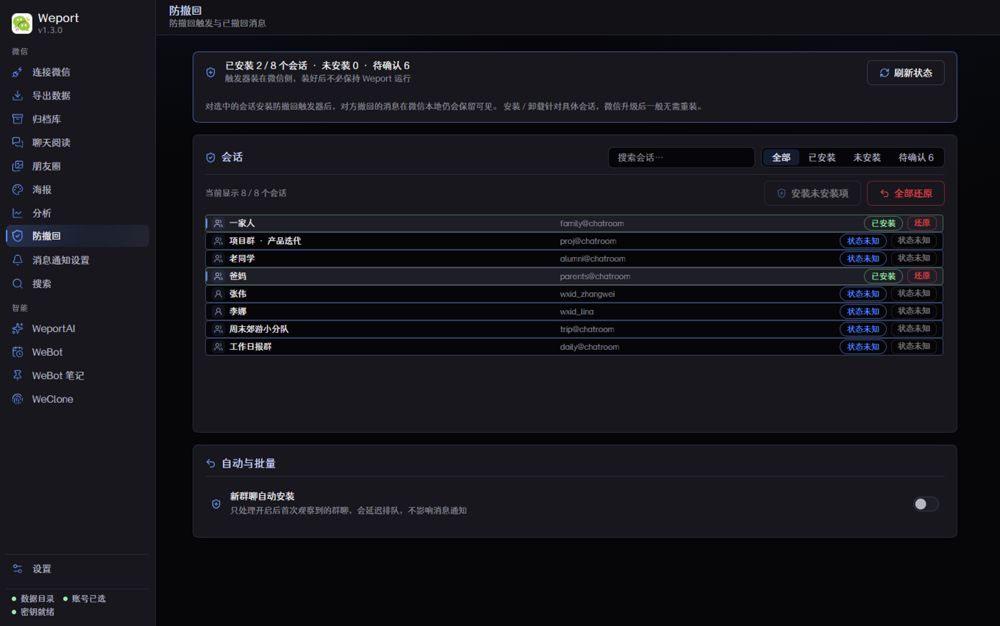

### 设置、存储与诊断

调整外观、配置模型、管理数据访问范围。V1.3 支持检查存储占用、校验后迁移文件，以及分步骤排查连接问题。

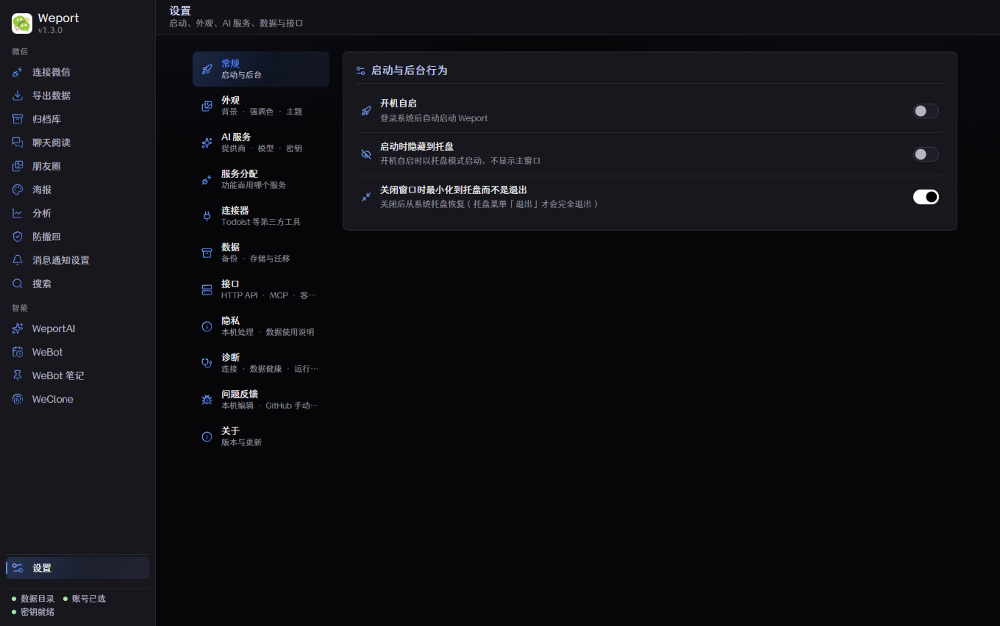
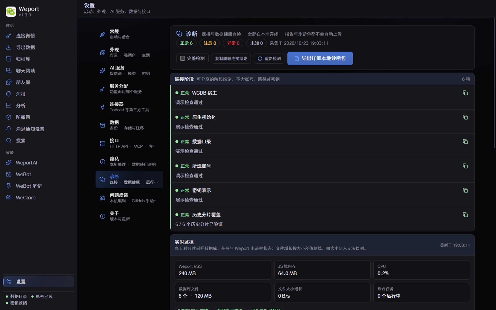
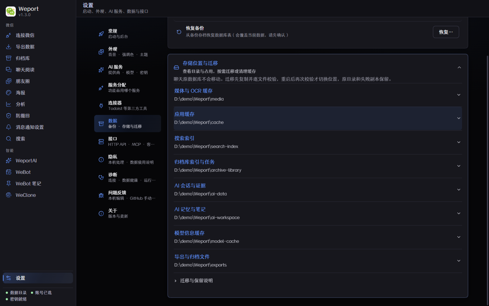

## 数据与隐私

- 阅读、普通搜索、导出和统计使用本机数据，不需要把聊天发给 AI。
- **使用远程 AI 时，相关聊天、工具读取结果、记忆、人格资料，以及启用图片理解时选中的图片，可能发送给你配置的模型服务。** WeportAI、WeBot 和 WeClone 都应按这一点判断。
- 需要仅在本机处理时，配置本机模型并启用相应的数据限制。
- 数据目录、密钥和模型配置保存在本机。若保存位置属于云同步文件夹，文件仍可能被你的同步软件上传。
- 应用不收集安装统计或远程错误报告。诊断结果保存在本机，由你决定是否提交。
- 反馈问题时优先复制诊断页的脱敏摘要。详细诊断包可能包含敏感信息，请检查后再分享，不要公开密钥或私人聊天。

## 常见问题

**关闭窗口后为什么还在运行？** 关闭窗口默认收起到托盘。需要完全退出时，在托盘菜单选择「退出」。开机启动和通知可以在设置中调整。

**找不到账号或无法连接？** 确认选择的是正确的微信数据目录和账号，再运行「连接诊断」。错误码、目录、密钥和数据库读取会分别检查。不要重命名安装目录中的 `WeFlow.exe`。

**为什么缺少图片或历史记录？** Weport 只能读取本机已有、且能够解密的数据。有些附件已过期、未下载或只剩缩略图；搜索和 AI 也可能受到索引覆盖范围的限制。

**AI 为什么没看完全部记录？** 历史可能很长，模型有上下文和使用量限制。查看回答中的来源与覆盖说明；必要时缩小会话或日期范围继续分析。

## 平台与安装包

| 平台 | 安装包 | 说明 |
|---|---|---|
| Windows x64 | `Setup.exe` | 当前公开版提供 Windows 安装包；本轮 V1.3 在 Windows 验证 |
| macOS Apple Silicon | `.dmg` / `.zip` | 请检查对应版本是否提供附件；本轮未完成原生运行验证 |
| Linux x64 | `.deb` / `.AppImage` / `.tar.gz` | 请检查对应版本是否提供附件；本轮未完成原生运行验证 |

Intel Mac 暂不支持。其他微信版本与第二账号的兼容性尚未在本轮全面验证。

[macOS 与 Linux 安装说明](docs/platform-installation.md) · [更新记录](RELEASE_NOTES.md)

## 开发与项目资料

基于 Electron、React、TypeScript 和原生 WCDB 引擎。

[开发与测试](docs/development.md) · [V1.3 当前进展](docs/v1.3-current-summary.md) · [V1.3 验证结果](docs/v1.3-release-readiness.md) · [问题审计](docs/v1.3-issue-audit.md)

## 使用范围与许可证

仅处理本人账号的数据，尊重聊天参与者的隐私，并遵守适用规则。请在清理或迁移重要数据前保留备份。

Weport 基于 **cc / hicccc77 与 WeFlow 贡献者**的作品修改。整体按 [CC BY-NC-SA 4.0](LICENSE) 分发：保留署名、仅限非商业用途，发布修改版时采用相同或兼容的许可证。第三方组件适用各自许可证。

[项目来源与改动](NOTICE.md) · [第三方声明](THIRD-PARTY-NOTICES.md) · [来源核查记录](docs/LEGAL-PROVENANCE.md)
